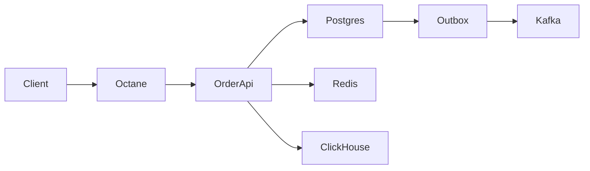

# Заказы: тестовый проект и ход работы

Живой план. Его правим по ходу, источник правды — этот файл, не черновик в чате.

## Где мы

Остановка 2026-11-10. Redis закрыт. В `outbox` есть строка заказа `13`: `awaiting_payment` → `paid`, `published_at` пустой. Дальше команда-релей в топик `order.events`.

Контур заказов на паузе. Сейчас в ветке `ai-demo` идёт фича для вакансии — [ai-content.md](ai-content.md). Ради неё OpenAPI из списка «не делаем» берётся раньше: только для ручек фичи.

Сделано: Docker-стек, Laravel 13, Octane/Swoole на порту `8000`, Sanctum, MCP Postgres (профиль `orders`, база `test_laravel`), модели `Order` и `OrderLine`, состояния Spatie, Policy владельца, сидер Anna и Andrey. Токен для Postman выпускается через `tinker`, отдельного маршрута входа нет. В `.env.example` есть `OCTANE_SERVER=swoole` и `REFUNDS_ENABLED=false`. Команды в чате пишем как `docker compose exec`, не через Make. `octane:reload` не используем: один раз он убил мастер Swoole. Код подхватывает `docker compose restart app`.

- [x] Памятка агента и журнал
- [x] Первый запуск `make up`
- [x] Laravel, Octane, Sanctum
- [x] MCP к Postgres
- [x] Пользователь, заказ, строки, API
- [x] Плохой SQL и индекс
- [x] Redis
- [ ] Генерация AI-контента, ветка `ai-demo` — [ai-content.md](ai-content.md)
- [ ] Kafka
- [ ] Дыра Octane
- [ ] Лог в ClickHouse

## Что это за проект

Один HTTP API заказа. Фронта нет: ни Blade-страниц, ни Livewire, ни React. Всё, что проверяем, идёт через `curl` к API. Админку из хвоста плана сами не начинаем.

Заказ всегда принадлежит пользователю. Без владельца не на чем показать ни внешний ключ, ни Policy. Регистрации и экрана входа нет: два пользователя появляются сидером, ходят в API с токеном Sanctum. Чужой заказ — 403.

Связи, которые смотрим в моделях: `User` hasMany `Order`, `Order` belongsTo `User`, `Order` hasMany `OrderLine`, строка belongsTo заказу. Строка — название и количество, без каталога товаров.

Заказ создаётся, его показывают, статус меняется по правилам. Состояния: `Draft` → `AwaitingPayment` → `Paid` → `Shipped`. Из ранних статусов можно `Cancelled`. Переход `Paid` → `Refunded` выключен конфигом `REFUNDS_ENABLED`. Незаконный переход — ошибка, не тихая перезапись поля.

Данные заказа лежат в Postgres. Смена статуса — в транзакции с блокировкой строки. Redis кэширует статус, ограничивает частоту создания и держит один внутренний job «после оплаты». Kafka получает событие уже после commit (таблица outbox, топик `order.events`, ключ — id заказа). ClickHouse хранит только строку лога об этой смене, не сам заказ.

Рядом один учебный маршрут Octane: копит id в `static`, второй запрос видит первый. Так видно, чем long-running worker отличается от обычного PHP.



Журнал — [journal.md](journal.md). Заголовок — дата и время, округлённые до получаса. Пока слот тот же, дописываем пункты в него, а не открываем новую простыню. Памятка для агента — [AGENTS.md](../AGENTS.md).

Не делаем, пока этот контур не работает: DDD-слои, PHPStan, OpenAPI, GrowthBook, S3, Livewire, React. На собесе про них хватает устной фразы.

## Канон Laravel

Код лежит там, куда его кладёт документация и `artisan make`. Своего каркаса, модулей и «слоя на всякий случай» нет.

- Маршруты API — `routes/api.php`, контроллеры — `app/Http/Controllers`, проверка входа — `auth:sanctum`.
- Валидация — Form Request, JSON-ответ — API Resource, доступ к чужому заказу — Policy. В контроллере этого кода нет.
- Модели, миграции, сидер, контроллер, запрос, ресурс, политика и job появляются командой `make:*`. Её запускаешь ты, тела файлов заполняю я и объясняю, что в каком файле делает Laravel.
- Конфиг читается через `config()` и файлы в `config/`. `env()` только внутри этих файлов.
- Очередь — обычный Job и `dispatch()`, соединение Redis в `config/queue.php`. Отдельный воркер пишем только для Kafka: в Laravel нет драйвера шины событий.
- Запись в ClickHouse — фасад `Http`, не сырой `curl` из контроллера.
- Состояния заказа — пакет Spatie, не самописный switch. В самом Laravel машины состояний нет. Подключаем так, как написано у пакета: трейт на модели `Order` и классы состояний рядом с ней.

Форматирование — Pint из скелета Laravel, когда файл уже готов. Гонять его на каждом чихе не будем.

## Как идём в тандеме

Один шаг за раз. Я не начинаю следующий, пока ты не написал, что текущий сошёлся, или не прислал ошибку из терминала.

На каждом шаге я говорю три вещи: что сейчас происходит, какую команду запускаешь ты, какой трабл здесь типичный. Код, который стоит прочитать глазами (миграция, смена статуса, outbox, static), пишу я — ты смотришь diff.

Никакие команды я сам не исполняю: ни `artisan`, ни `composer`, ни `docker`, ни `curl`, ни `git`, ни в терминале, ни фоном. Пока ты отдельно не написал «запускай» на эту конкретную команду, я её только показываю. «Сделай миграцию» значит «напиши файл», а не «выполни migrate».

`.env` заполняешь ты. Содержимое в чат не присылай. Если команда просит пароль или токен — останавливаемся, шаг делаешь сам.

Коммиты делаешь ты. Я не запускаю `git add` и `git commit`. В конце шага могу сказать, что именно легло в файлы и какая фраза подошла бы к коммиту. Делать его или нет — решаешь ты.

Кто что делает по умолчанию:

- Файлы Docker, миграции, PHP-код, журнал, `AGENTS.md`, этот план — я.
- `docker compose`, `composer`, `artisan`, `curl`, `psql`, `redis-cli` — всегда ты.
- Запустить команду за тебя можно только отдельной фразой «запускай» на ту команду, которую я только что показал. Без неё я останавливаюсь на тексте команды.

## Инструменты по этапам

- Шаги 0–1. Docker Compose, образ `phpswoole/swoole:6.2-php8.5`, расширения `pdo_pgsql`, `redis`, `rdkafka`, OPcache. Рядом контейнеры Postgres 16, Redis 7, Kafka KRaft, ClickHouse. Редактор — файлы в репозитории.
- Шаг 2. Composer (`laravel/laravel` 13, `laravel/octane`, `laravel/sanctum`, `spatie/laravel-model-states`), Artisan (`octane:install`, установка API Sanctum). Breeze и форму логина не ставим.
- Шаг 3. Cursor MCP, сервер `@microsoft/postgres-mcp`. Конфиг `.cursor/mcp.json` без пароля, строка подключения из `.env`. Включается, когда Postgres уже отвечает.
- Шаги 4–5. Artisan `make:model`, `make:controller`, `make:request`, `make:resource`, `make:policy`, `make:seeder`, `migrate`. Eloquent-связи и `EXPLAIN` в `psql` или через MCP, если попросишь меня посмотреть схему.
- Шаг 6. Redis из Laravel (`Cache`, `RateLimiter`, `Cache::lock`, очередь) и `redis-cli` для проверки.
- Шаг 7. Расширение `rdkafka`, своя команда Artisan (релей и consumer), `docker compose exec` чтобы увидеть топик. Отдельный MCP для Kafka и Redis не ставим.
- Шаг 8. Тот же Octane/Swoole, два запроса с хоста.
- Шаг 9. HTTP ClickHouse на порт 8123 из приложения и один `SELECT` у тебя в консоли. MCP ClickHouse пробуем только если сервер стартует за пару минут, иначе обходимся SQL.

## Шаги

### 0. Памятка агента

Сделано. В репозитории лежат `AGENTS.md`, `docs/journal.md` и этот файл. `.cursor/mcp.json` появится на шаге 3, когда будет Postgres.

### 1. Docker

Dockerfile PHP лежит в `deploy/docker/dev/php`. Корневой `docker-compose.yml` поднимает `app`, Postgres 16, Redis 7, Kafka KRaft и ClickHouse. Таблица `app_logs` создаётся `deploy/docker/dev/clickhouse/init.sql` при пустом томе.

Дальше ты запускаешь `make up` и присылаешь в чат только факт: поднялось или текст ошибки. Пароли из вывода вырежи. Остановка — `make down`. Оболочка контейнера — `make shell`.

Трабл: сборка `rdkafka` долгая, это не зависание. Частая ошибка — порт 5432 или 9092 уже занят на машине. Тогда останавливаемся и меняем проброс порта, а не угадываем процесс. `pecl install rdkafka` может не найти заголовки, если пакет `librdkafka-dev` не встал.

### 2. Laravel и пакеты

Я даю команды по одной. Ты выполняешь их в контейнере `app` и смотришь вывод.

Первая команда, контейнер `app` уже запущен. Корень репозитория не пустой, поэтому каркас собирается во временный каталог. В git он попадёт только после переноса в корень и настройки. `/tmp` внутри контейнера не на томе: `make down` или пересоздание `app` его сотрёт, поэтому переносим сразу после успешной установки.

```bash
docker compose exec app composer create-project laravel/laravel:^13.0 /tmp/laravel --no-interaction
```

Дальше, когда установка пройдёт: перенос в корень без затирания `.env`, `docs` и `deploy`, затем Octane, Sanctum и Spatie model states, `octane:install` с сервером Swoole, в `.env` хосты Postgres и Redis (имена сервисов compose, не localhost). Файл `.env` ты правишь сам. Этот настроенный каркас и есть коммит каркаса приложения.

Трабл: `composer create-project` в непустой каталог ругается на `.idea` и наши md-файлы. Обойдём флагом или временным каталогом, это разберём на месте, не заранее пачкой команд. Второй трабл: Octane не видит расширение Swoole, если Artisan запущен не в том контейнере.

### 3. MCP к Postgres

Файл `.cursor/mcp.json` запускает `@microsoft/postgres-mcp`. Пароль в файл не пишется: профиль `orders` создаёшь ты, пароль уходит в связку ключей. Потом включаешь сервер в настройках Cursor и пишешь мне «MCP включён».

Я спрашиваю у Postgres список баз. Ты по ответу видишь, что агент ходит в локальную БД сам. Пароль в журнал и в чат не попадает.

Трабл: сервер красный, потому что Cursor не видит `npx` или Postgres ещё не healthy. Чиним запуск, к миграциям не переходим.

### 4. Пользователь, заказ, строки, API

Ты пишешь «сделай миграцию». Я даю команды `make:model` для заказа и строки заказа с флагом миграции. Ты их запускаешь. Я заполняю сгенерированные файлы и показываю, куда смотреть. Таблица `users` уже есть в каркасе. В `orders` — `user_id` с внешним ключом на `users`, статус строкой, сумма. В `order_lines` — `order_id` с внешним ключом, название, количество. Индексы под фильтр статуса пока не добавляю. Ты запускаешь `php artisan migrate`.

Дальше по твоей отмашке ты так же создаёшь через `make:*` контроллер, Form Request, API Resource, Policy и сидер. Я заполняю эти файлы: связи моделей, состояния Spatie на модели `Order`, два пользователя в сидере, Policy «только свой заказ», смена статуса через `lockForUpdate` в транзакции, маршруты в `routes/api.php` под `auth:sanctum`. Объясняю, чем состояния похожи на `symfony/workflow`, почему параллельный запрос не проводит заказ дважды и чем Policy отличается от проверки `user_id` прямо в контроллере.

Токен ты выпускаешь сам командой, которую я дам, и подставляешь его в `curl`. В чат токен не присылай. Проверки: без заголовка — 401, своим токеном заказ создаётся и читается вместе со строками и владельцем, чужим токеном тот же id — 403, незаконный переход — ошибка.

Трабл: миграция «ничего не произошло» — Artisan смотрит в другую БД, чем MCP. Сверяем хост в `.env`, не содержимое файла в чате. 401 на всех маршрутах — запрос ушёл без `Authorization: Bearer`. Запрещённый переход всё же записывается, если статус обновили через `update()`, минуя классы состояний.

### 5. Плохой SQL и индекс

Я добавляю список заказов, который в цикле трогает владельца и строки: это N+1 по связям `user` и `lines`. Индекса по `(status, created_at)` пока нет. Объясняю, почему после Doctrine это всплывает сразу: у Eloquent нет identity map. Потом список чинится через `with()`, и это видно в числе запросов.

Ты гоняешь `EXPLAIN (ANALYZE, BUFFERS)` сам в `psql` или просишь меня снять план через MCP. Потом я добавляю миграцию индекса, ты снова `migrate` и сравниваешь план.

Трабл: на пустой таблице индекс «не нужен», план врёт. Тогда ты вставляешь несколько тысяч строк командой, которую я дам, и повторяешь `EXPLAIN`.

### 6. Redis

Я подключаю к тем же ручкам TTL-кэш статуса, throttle на создание, идемпотентность по заголовку `Idempotency-Key` и один Job после оплаты. Job ты создаёшь командой `make:job`, тело пишу я. Очередь — штатное соединение `redis`.

Ты проверяешь: повторный `curl` с тем же ключом не создаёт второй заказ, лишние создания упираются в throttle, в `redis-cli` виден ключ и TTL. Команды даю я.

Трабл: кэш Octane и кэш Redis путают. Статус в Redis переживёт перезапуск worker, static — нет. Если job не выполняется, воркер очереди просто не запущен: это отдельная команда `queue:work`, её стартуешь ты.

### 7. Kafka

Я пишу миграцию `outbox` (ты запускаешь `make:migration`), запись в ту же транзакцию, что и статус, и команду Artisan, которая публикует в `order.events`. Команду ты создаёшь через `make:command`. Consumer пишет id сообщения в `processed_messages` и второй раз его не проводит. Это единственное место, где нет готового механизма Laravel: шину Kafka фреймворк не умеет.

Ты запускаешь релей и consumer, меняешь статус через `curl`, смотришь, что в топике одно сообщение, а повторный запуск релея не дублирует обработку.

Трабл: брокер ещё не готов, клиент падает с «connection refused» — ждём healthy, а не меняем код. Второе: событие ушло в Kafka, а транзакция заказа откатилась. Так бывает, если публиковать до commit. У нас публикация только из outbox после commit, на это смотришь в коде.

### 8. Дыра Octane

Я добавляю маршрут, который копит id заказов в `static`, и рядом нормальный вариант без static. Коротко разбираю, что ещё течёт между запросами: синглтон, запомнивший первого пользователя Sanctum, слушатель, повешенный внутри запроса, OPcache до `octane:reload`, перезапуск worker по `max_requests`. Swoole здесь — пул процессов, запрос за запросом; корутины сами по себе Laravel безопасным не делают. Чужой пользователь во втором запросе — та же дыра, что и чужой id заказа.

Ты дважды открываешь учебный маршрут и видишь чужой id во втором ответе. Потом дергаешь нормальный маршрут и чужого id нет.

Трабл: правка файла «не применилась». Worker уже держит старый код, нужен `octane:reload`, команду даю я, выполняешь ты. Если оба маршрута ведут себя одинаково, смотрим, не попал ли запрос в `php artisan serve` мимо Octane.

### 9. Лог в ClickHouse

Я дописываю отправку одной строки (`ts`, `level`, `message`, `order_id`) на HTTP ClickHouse после успешного commit. Ошибка отправки заказ не откатывает.

Ты меняешь статус и делаешь `SELECT` по `app_logs`. Я в журнале фиксирую, чем колоночная таблица отличается от Postgres: скан по полям дешёвый, точечные правки статуса тут не живут.

Трабл: вставка не взлетела за полчаса. Контейнер не выкидываем, в журнале остаётся честная пометка, на собесе говоришь, что движок видел, боевой записи ещё нет.

## После контура

Если время осталось и ты сам просишь следующий кусок, по одному: тест Pest на переход, OpenAPI, флаг через GrowthBook, файл в MinIO, страница Livewire. Сам я хвост не начинаю.
